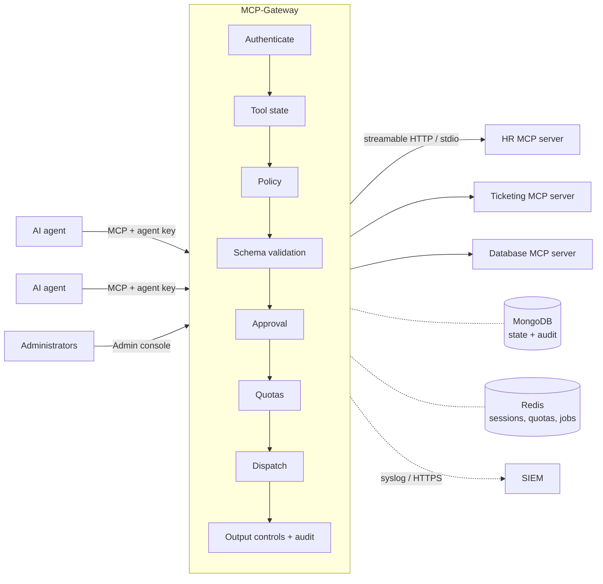
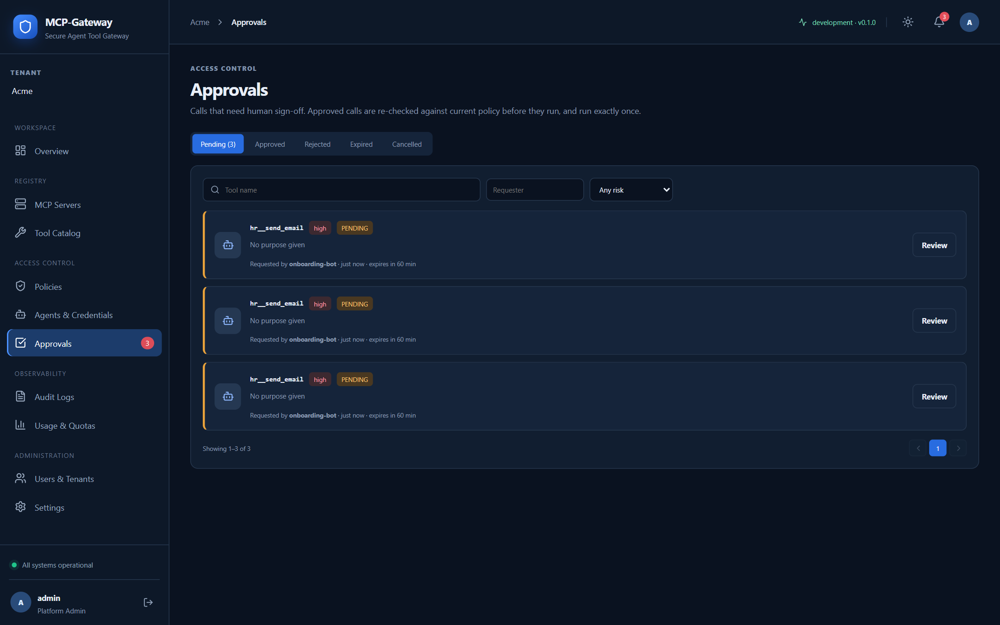
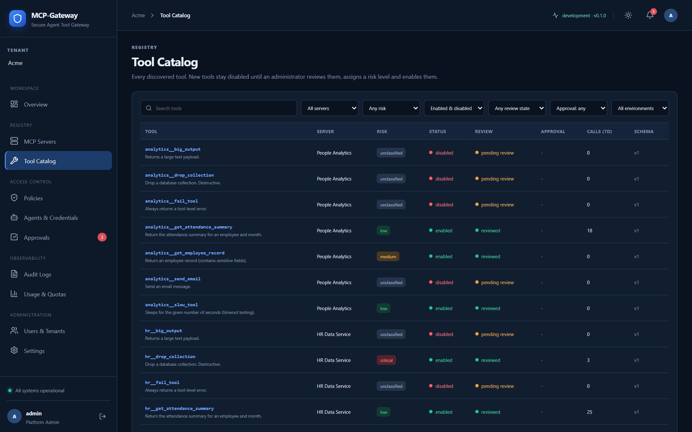
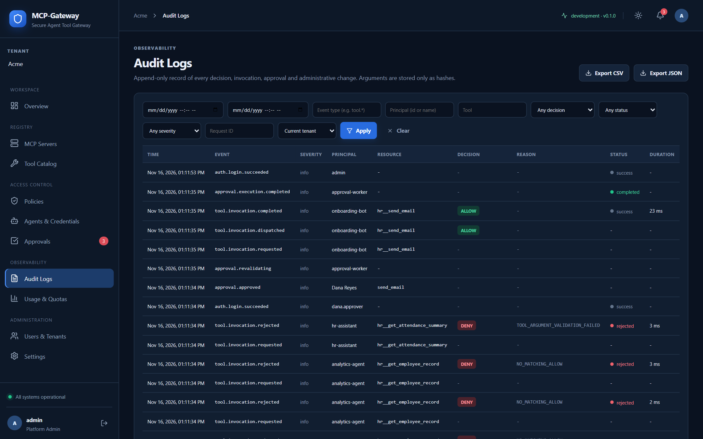

<div align="center">

<picture>
  <source media="(prefers-color-scheme: dark)" srcset="docs/assets/logo-wordmark-dark.svg">
  
</picture>

**A self-hosted security gateway between AI agents and the tools they use.**<br>
One governed MCP endpoint with default-deny policy, human approval, quotas and a complete audit trail.<br>
Built for on-premises and air-gapped environments.

[](https://github.com/mkamranr/mcp-gateway/actions/workflows/ci.yml)


[Features](#features) · [How it works](#how-it-works) · [Quick start](#quick-start) · [Deployment](#production-deployment) · [Documentation](#documentation)

<br>


</div>

## Why MCP-Gateway

The Model Context Protocol makes it easy to give AI agents tools: HR systems, ticketing, databases, email. It does
not decide **which** agent may call **which** tool, with **what** arguments, how often, or who signs off on the
risky ones. Connecting agents straight to MCP servers leaves that to every server and every agent.

MCP-Gateway puts one enforcement point in between. Agents connect to a single MCP endpoint with their own
credential. They see only the tools they are allowed to use. Every call is authorized against policy, validated
against the tool's schema, counted against quotas, sent for human approval when required, and recorded in an
append-only audit log, before anything reaches the upstream server.

## Features

<table>
<tr>
<td width="50%" valign="top">

### 🛡️ Access control
- **Default-deny policy engine.** Allow and deny rules over agents, users, roles, servers, tools, risk levels
  and actions. Conditions on environment, time window, source network and rate. Deny always wins.
- **Policy simulator and history.** Test a request without executing it; every version is kept.
- **Policy as code.** YAML bundles in git, with a field-level `plan` and an all-or-nothing `apply` that makes
  exactly the reviewed changes.
- **Tool review.** New tools stay disabled until reviewed. A changed schema blocks calls until acknowledged.

</td>
<td width="50%" valign="top">

### ✅ Human in the loop
- **Approvals** for sensitive or critical tools: 1 or 2 approvers, separation of duties, expiry, and typed
  confirmation for critical actions.
- **Always someone to decide.** Time-boxed delegation for absences, approver groups from SSO, escalation of
  stale requests, and expiry reminders sent to your SIEM.
- **Tamper-proof requests.** Arguments are bound by SHA-256 hash and AES-GCM encryption; the worker re-checks
  credential, policy and tool state before running the call **exactly once**.

### 📊 Limits and output controls
- Atomic quotas and concurrency limits per tenant, agent, tool and upstream server.
- Output size caps, schema validation and field redaction. Tool output is marked untrusted.

</td>
</tr>
<tr>
<td valign="top">

### 🔐 Identity and tenancy
- Multi-tenant, with tenant isolation enforced in every data access path.
- Agents authenticate with hashed, rotatable, revocable API keys (`mgw_live_…`).
- Console users: Argon2id passwords, server-side sessions, CSRF protection, six roles.
- **Single sign-on (OIDC)** with Keycloak, Entra ID, AD FS and others; IdP groups map to roles.
- **OAuth 2.0 for agents:** agents can authenticate with client-credentials access tokens from Entra ID,
  Keycloak, Okta and others instead of gateway keys.
- **LDAP / Active Directory sign-in** over LDAPS or StartTLS; directory groups (including nested AD groups) map
  to roles, with break-glass local administrators.
- **SCIM 2.0 provisioning** from Entra ID, Okta and others: accounts and group memberships follow the IdP as
  soon as they change there, and deactivating a user ends their sessions at once.
- **Mutual TLS.** Agents can authenticate with client certificates from your PKI (SPIFFE IDs or pinned
  certificates), and the gateway presents client certificates to upstreams that require them.

</td>
<td valign="top">

### 🔎 Audit and operations
- Append-only, correlated audit trail with search and audited export.
- **SIEM forwarding** to syslog (TLS/TCP/UDP) or HTTP collectors such as Splunk HEC, as JSON or CEF.
- Prometheus metrics, usage dashboards, upstream health checks.
- **High availability.** Stateless API and workers; MongoDB replica sets and Redis Sentinel, with failover
  tested under load in CI.
- Tested backup and restore scripts.

</td>
</tr>
</table>

## How it works



The MCP endpoint, the REST API and the approval worker all run the **same** pipeline, so there is no side door.
If a dependency needed for a safe decision (policy store, quota store, audit log) is unavailable, the gateway
**fails closed**.

## Screenshots

<table>
<tr>
<td width="50%"><p align="center"><sub><b>Policies</b>: default deny, conditions, broad-grant warnings and policy as code</sub></p></td>
<td width="50%"><p align="center"><sub><b>Approvals</b>: human sign-off for sensitive tools</sub></p></td>
</tr>
<tr>
<td><p align="center"><sub><b>Tool catalog</b>: review status, risk levels, schema versions</sub></p></td>
<td><p align="center"><sub><b>Audit log</b>: every decision, correlated and exportable</sub></p></td>
</tr>
</table>

## Quick start

Run everything locally without Docker. Requirements: [uv](https://docs.astral.sh/uv/) (Python 3.12) and
Node.js 20+.

```bash
make install    # uv sync + npm ci
make dev        # MongoDB (in-memory) + Redis (fake) + mock MCP server + API on :8080 + worker
make dev-ui     # in a second terminal: console on http://localhost:5173
```

`make dev` prints a generated admin password and the URL of a mock upstream MCP server. Then:

1. Sign in and open **MCP Servers → Add server**. Enter the mock URL and enable *Allow private network*.
2. Click **Refresh tools**, open a tool, assign a risk level and enable it.
3. Under **Agents & Credentials**, register an agent and create a key (it is shown once).
4. Under **Policies**, allow the agent to use the tool. Add a policy with *Require approval* for a sensitive tool.
5. Run the demo agent:
   ```bash
   MGW_URL=http://127.0.0.1:8080/mcp MGW_AGENT_KEY=mgw_live_... \
     uv run --project backend python deploy/examples/demo_agent.py
   ```
6. Approve the pending request as a *different* user with the Approver role, then watch it complete in
   **Audit Logs**.

To try single sign-on, start the stack with a built-in mock identity provider:
`cd backend && uv run python -m devtools.dev_stack --with-oidc`, then `make dev-ui`. Demo users are `alice`,
`bob`, `carol` and `root`.

## Connecting an agent

Any MCP client that supports streamable HTTP works:

```json
{
  "mcpServers": {
    "mcp-gateway": {
      "type": "streamable-http",
      "url": "https://mcp-gateway.example.internal/mcp",
      "headers": { "Authorization": "Bearer ${MGW_AGENT_KEY}" }
    }
  }
}
```

Tools appear as `<server>__<tool>`, for example `hr__get_attendance_summary`. See
[MCP client configuration](docs/mcp-client-configuration.md) for Python and other clients.

## Production deployment

Docker Compose or Kubernetes (Helm), with every image pinned and loadable from an offline bundle.

```bash
./deploy/scripts/generate-secrets.sh     # once: writes ./secrets/
cp .env.example .env                     # adjust non-secret settings
docker compose up -d --wait
```

| Topology | How |
|---|---|
| **Single host** | `docker-compose.yml`. Only the web UI publishes a port; MongoDB and Redis stay on an internal network. |
| **Several replicas** | add `-f docker-compose.ha.yml`: 2 API replicas and 2 workers, scalable with `--scale`. |
| **Multi-host HA** | MongoDB replica set and Redis Sentinel behind a load balancer. See [high availability](docs/high-availability.md). |
| **Kubernetes** | Helm chart in `deploy/helm/mcp-gateway`: restricted Pod Security, network policies, optional ingress, agent mTLS and bundled or external databases. See [Kubernetes](docs/kubernetes.md). |
| **Air-gapped** | build an image bundle with checksums on a connected machine and load it offline. See [air-gapped installation](docs/air-gapped-installation.md). |

Backups: `deploy/scripts/backup.sh` and `restore.sh`. A restore verifies that every stored secret decrypts before
it starts serving traffic. See [operations](docs/operations.md).

## Technology

| Layer | Stack |
|---|---|
| Gateway API and worker | Python 3.12, FastAPI, official MCP SDK, Pydantic, PyMongo (async), redis-py |
| Data | MongoDB 7 (state and audit), Redis 7 (sessions, quotas, job queue, leases) |
| Admin console | React 19, TypeScript 7, Vite 8, TanStack Query. All assets bundled, no CDN |
| Delivery | Docker Compose, nginx (unprivileged), read-only containers with all capabilities dropped |

## Repository layout

| Path | Contents |
|---|---|
| `backend/app` | FastAPI app: `api/v1` routes, `services` (business logic), `repositories` (tenant-scoped data access), `mcp` (gateway endpoint, upstream adapters, SSRF guard), `workers`, `tools` (key rotation, data verification) |
| `backend/tests` | unit, integration, contract (real MCP SDK client) and security suites |
| `backend/devtools` | mock MCP server, mock OIDC provider, Docker-free dev stack |
| `frontend/src` | admin console: `app` (shell, auth, routing), `features/*` (one folder per page), `components`, `services` |
| `deploy` | Helm chart, secret generation, backup and restore, offline bundle, SBOM, policy-as-code CLI, demo agent |
| `docs` | architecture, security and threat model, API, deployment, operations and feature guides |

## Quality

```bash
make check    # ruff + mypy + tsc + full pytest suite + production build
```

Every push and pull request runs the Backend, Frontend and Dependency scan jobs in GitHub Actions. The Docker-based
integration jobs (Compose smoke test and below) run on demand: **Actions → CI → Run workflow**, or
`gh workflow run ci.yml --ref <branch>`. Run them before merging anything that touches the backend, deployment
or CI.

| Job | What it verifies |
|---|---|
| **Backend** | lint (ruff), type checking (mypy), and the full test suite against real MongoDB 7 and Redis 7 |
| **Frontend** | typecheck, production build, and a check that the bundle references no external origin |
| **Dependency scan** | `pip-audit` and `npm audit` on production dependencies |
| **Compose smoke test** | starts the full stack with **all internet egress blocked**, checks health, ports, auth, CSRF and security headers, drives SCIM provisioning as Entra ID and Okta do, runs the policy-as-code CLI, and performs a **backup → wipe → restore** drill, including refusing a damaged archive and a wrong encryption key |
| **Multi-replica** | two API replicas and two workers: concurrent first boot, a replica stopped under load with no failed requests, scale-out picked up without a proxy reload, worker failover |
| **Failover** | MongoDB replica set and Redis Sentinel: the primary, then the master, is killed under load with approvals in flight. Only fail-closed 503s, automatic recovery, every approved call run exactly once, nothing missing from the audit log |
| **mTLS** | through the real nginx: agents served by client certificate over REST and MCP; no certificate, a foreign CA, an unregistered certificate, a spoofed certificate header and a revoked credential are all refused; an upstream that requires a client certificate is reached only with one |
| **LDAP** | against a real OpenLDAP server: LDAPS and StartTLS, refusal of a host name not in the certificate, a foreign CA and clear text; group search and `memberOf` roles; unmapped users, wrong passwords and filter injection refused; removing a user from a group removes access; local administrators still sign in when the directory is down |
| **Agent OAuth** | against a real Keycloak: client-credentials tokens accepted over REST and MCP and audited against the OAuth credential; tokens for another client, without the gateway's audience, ID tokens, tampered tokens and tokens missing a required scope refused; revocation immediate |
| **Kubernetes** | the Helm chart on kind, in a namespace enforcing the restricted Pod Security Standard: `helm test`, the smoke and SCIM checks through the web UI, the agent mTLS listener, network policies blocking an unrelated pod, a rolling restart without failed requests, and a generated Secret kept across upgrade and uninstall |

A manual release workflow builds the air-gap bundle, deletes every image, then loads and starts the bundle with
egress blocked, as an air-gapped host would.

## Documentation

| Topic | Guide |
|---|---|
| Design | [Architecture](docs/architecture.md) · [Security model](docs/security-model.md) · [Threat model](docs/threat-model.md) |
| Integration | [API reference](docs/api-reference.md) · [MCP client configuration](docs/mcp-client-configuration.md) |
| Deployment | [Deployment](docs/deployment.md) · [Kubernetes](docs/kubernetes.md) · [Air-gapped installation](docs/air-gapped-installation.md) · [High availability](docs/high-availability.md) |
| Features | [Approvals and delegation](docs/approvals.md) · [Single sign-on](docs/sso.md) · [LDAP / Active Directory](docs/ldap.md) · [SCIM provisioning](docs/scim.md) · [Agent OAuth](docs/agent-oauth.md) · [Mutual TLS](docs/mtls.md) · [SIEM forwarding](docs/siem.md) · [Policy as code](docs/policy-as-code.md) |
| Running it | [Operations and runbooks](docs/operations.md) |

## Security

Please report vulnerabilities privately as described in the [security policy](SECURITY.md). Do not open public
issues for security problems.

## Contributing

See [CONTRIBUTING.md](CONTRIBUTING.md) for the development setup, coding conventions and the checks a change
must pass.
