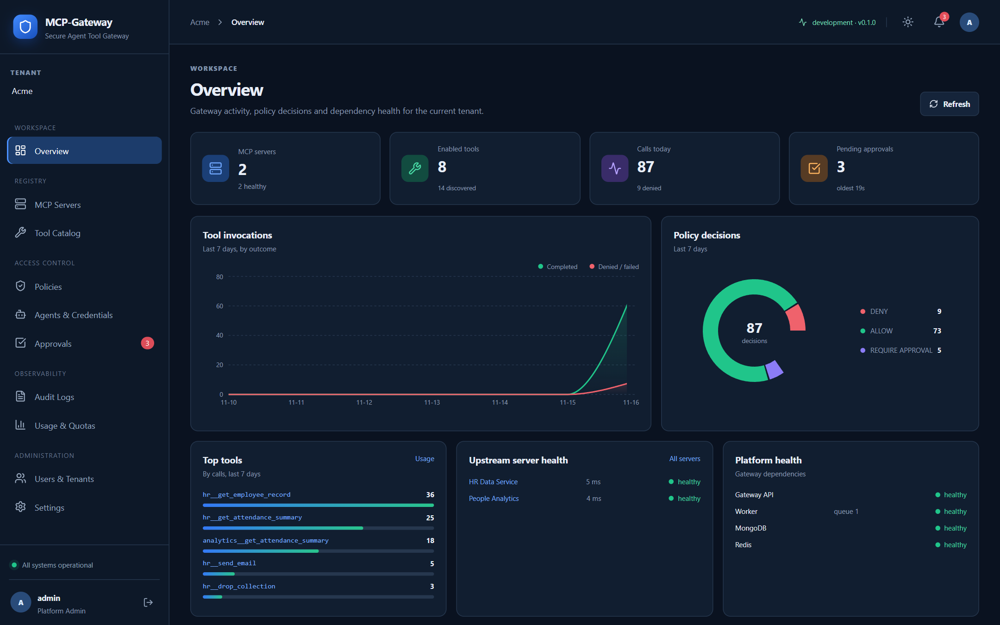
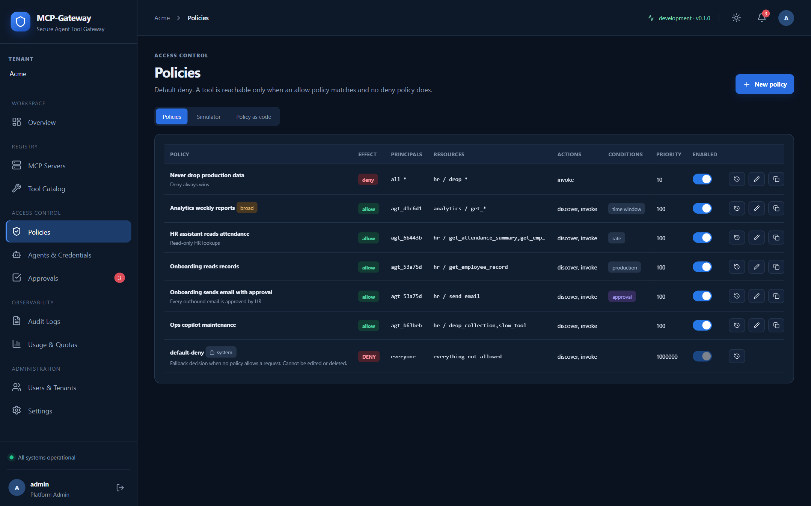

<div align="center">

<picture>
  <source media="(prefers-color-scheme: dark)" srcset="docs/assets/logo-wordmark-dark.svg">
  
</picture>

**A self-hosted security gateway between AI agents and the tools they use.**

One governed MCP endpoint with default-deny policy, human approval, quotas and a complete audit trail.<br>
Built for on-premises and air-gapped environments.

[](https://github.com/mkamranr/mcp-gateway/actions/workflows/ci.yml)


[Overview](#overview) · [Features](#features) · [Architecture](#architecture) · [Quick start](#quick-start) · [Deployment](#deployment) · [Documentation](#documentation)

<br>



</div>

## Overview

The Model Context Protocol makes it easy to give AI agents tools: HR systems, ticketing, databases, email. It
does not decide **which** agent may call **which** tool, with **what** arguments, how often, or who signs off on
the risky ones. Connecting agents directly to MCP servers leaves those decisions to every server and every agent.

MCP-Gateway is a single enforcement point between them. Agents connect to one MCP endpoint with their own
credential and see only the tools they are allowed to use. Before anything reaches an upstream server, every call
is:

1. **authenticated** with the agent's own credential,
2. **authorized** against default-deny policy,
3. **validated** against the tool's reviewed schema,
4. **counted** against quotas and concurrency limits,
5. **held for human approval** when the tool or policy requires it, and
6. **recorded** in an append-only audit log.

## Features

### Access control

- **Default-deny policy engine.** Allow and deny rules over agents, users, roles, servers, tools, risk levels and
  actions, with conditions on environment, time window, source network and rate. Deny always wins.
- **Policy simulator and version history.** Test a request without executing it; every version is kept.
- **Policy as code.** YAML bundles in Git with a field-level `plan` and an all-or-nothing `apply`.
- **Tool review.** Newly discovered tools stay disabled until reviewed. A changed schema blocks calls until it is
  acknowledged.

### Human approval

- One or two approvers for sensitive tools, with separation of duties, expiry and typed confirmation for critical
  actions.
- Time-boxed delegation, approver groups from SSO, escalation of stale requests and expiry reminders.
- Arguments are bound by SHA-256 hash and AES-GCM encryption. Before running an approved call **exactly once**, the
  worker re-checks the credential, policy, tool schema and server configuration.

### Identity and tenancy

| Who | How they authenticate |
|---|---|
| **Agents** | Hashed, rotatable API keys · OAuth 2.0 client-credentials tokens (Entra ID, Keycloak, Okta) · mutual TLS client certificates (SPIFFE IDs or pinned certificates) |
| **Administrators** | Local accounts (Argon2id) · OIDC single sign-on · LDAP / Active Directory · SCIM 2.0 provisioning |

- Multi-tenant, with isolation enforced in every data access path, and six roles.
- Server-side sessions, CSRF protection, a strict Content Security Policy and break-glass local accounts.
- Master keys can be wrapped by HashiCorp Vault Transit or any KMS or HSM and unwrapped only in memory.

### Limits and output controls

- Atomic quotas and concurrency limits per tenant, agent, tool and upstream server.
- Output size caps, output schema validation and field redaction. Tool output is marked untrusted.
- SSRF protection for upstream connections: connect-time DNS checks, IP pinning and always-blocked ranges.

### Audit and operations

- Append-only, correlated audit trail with search and audited CSV export.
- SIEM forwarding to syslog (TLS, TCP, UDP) or HTTP collectors such as Splunk HEC, as JSON or CEF.
- Prometheus metrics, usage dashboards and upstream health checks.
- Stateless API and workers for high availability, with MongoDB replica sets and Redis Sentinel.
- Backup and restore scripts that verify every stored secret decrypts before the gateway serves traffic.

## Architecture


The MCP endpoint, the REST API and the approval worker share one invocation pipeline, so there is no side door. If
a dependency needed for a safe decision (policy store, quota store or audit log) is unavailable, the gateway
**fails closed**.

| Component | Technology |
|---|---|
| Gateway API and worker | Python 3.12, FastAPI, the official MCP SDK, Pydantic, PyMongo (async), redis-py |
| Data | MongoDB 7 (state and audit), Redis 7 (sessions, quotas, job queue, leases) |
| Admin console | React 19, TypeScript, Vite, TanStack Query. All assets bundled; no CDN |
| Delivery | Docker Compose or Helm, unprivileged nginx, read-only containers with all capabilities dropped |

## Screenshots

<table>
<tr>
<td width="50%"><p align="center"><sub><b>Policies</b>: default deny, conditions and policy as code</sub></p></td>
<td width="50%"><p align="center"><sub><b>Approvals</b>: human sign-off for sensitive tools</sub></p></td>
</tr>
<tr>
<td><p align="center"><sub><b>Tool catalog</b>: review status, risk levels and schema versions</sub></p></td>
<td><p align="center"><sub><b>Audit log</b>: every decision, correlated and exportable</sub></p></td>
</tr>
</table>

## Quick start

Run the full stack locally without Docker. Requirements: [uv](https://docs.astral.sh/uv/) (Python 3.12) and
Node.js 20 or later.

```bash
make install    # uv sync + npm ci
make dev        # in-memory MongoDB, fake Redis, a mock MCP server, the API on :8080 and the worker
make dev-ui     # second terminal: the console on http://localhost:5173
```

`make dev` prints a generated administrator password and the URL of a mock upstream MCP server.

1. Sign in and open **MCP Servers → Add server**. Enter the mock URL and enable *Allow private network*.
2. Click **Refresh tools**, open a tool, assign a risk level and enable it.
3. Under **Agents & Credentials**, register an agent and create a key. It is shown once.
4. Under **Policies**, allow the agent to use the tool, and add a policy with *Require approval* for a sensitive
   tool.
5. Run the demo agent:
   ```bash
   MGW_URL=http://127.0.0.1:8080/mcp MGW_AGENT_KEY=mgw_live_... \
     uv run --project backend python deploy/examples/demo_agent.py
   ```
6. Approve the pending request as a *different* user with the Approver role, then follow it in **Audit Logs**.

To try single sign-on, start the stack with the built-in mock identity provider
(`cd backend && uv run python -m devtools.dev_stack --with-oidc`), then run `make dev-ui`. The demo users are
`alice`, `bob`, `carol` and `root`.

## Connecting an agent

Any MCP client that supports streamable HTTP can connect:

```json
{
  "mcpServers": {
    "mcp-gateway": {
      "type": "streamable-http",
      "url": "https://mcp-gateway.example.internal/mcp",
      "headers": { "Authorization": "Bearer ${MGW_AGENT_KEY}" }
    }
  }
}
```

Tools appear as `<server>__<tool>`, for example `hr__get_attendance_summary`. See
[MCP client configuration](docs/mcp-client-configuration.md) for Python and other clients.

## Deployment

Every image is pinned and can be loaded from an offline bundle.

```bash
./deploy/scripts/generate-secrets.sh     # once: writes ./secrets/
cp .env.example .env                     # adjust non-secret settings
docker compose up -d --wait
```

| Topology | How |
|---|---|
| **Single host** | `docker-compose.yml`. Only the web UI publishes a port; MongoDB and Redis stay on an internal network. |
| **Several replicas** | Add `-f docker-compose.ha.yml` for two API replicas and two workers, scalable with `--scale`. |
| **Multi-host HA** | MongoDB replica set and Redis Sentinel behind a load balancer. See [high availability](docs/high-availability.md). |
| **Kubernetes** | Helm chart in `deploy/helm/mcp-gateway`: restricted Pod Security, network policies, optional ingress and agent mTLS. See [Kubernetes](docs/kubernetes.md). |
| **Air-gapped** | Build an image bundle with checksums on a connected machine and load it offline. See [air-gapped installation](docs/air-gapped-installation.md). |

Backup, restore, key rotation and incident runbooks are in [operations](docs/operations.md).

## Security

- **Default deny everywhere.** No tool is exposed until an administrator reviews and enables it and a policy
  allows it.
- **Least privilege for tenant roles.** stdio servers are platform-administrator only. Changing where a server
  connects requires re-entering its credential. Policies can only narrow who may approve.
- **Secrets are write-only.** Upstream, SIEM, SSO and LDAP credentials are encrypted at rest. They never appear in
  API responses, logs or the audit trail, and are only sent to the destination they were entered for.
- **Trusted client addresses.** Forwarded headers are believed only from configured proxies, and client
  certificates only from the TLS proxy that verified them.

The [security model](docs/security-model.md) and [threat model](docs/threat-model.md) describe the controls and
residual risks, including the findings of an internal security review. Please report vulnerabilities privately, as
described in the [security policy](SECURITY.md).

## Testing

```bash
make check    # ruff, mypy, tsc, the full pytest suite and a production build
```

Every push and pull request runs the **Backend**, **Frontend** and **Dependency scan** jobs. The Docker-based
integration jobs run on demand (**Actions → CI → Run workflow**, or
`gh workflow run ci.yml --ref <branch> -f job=<name>`).

| Job | What it covers |
|---|---|
| **Backend** | ruff, mypy and the full test suite (unit, integration, contract and security) against real MongoDB 7 and Redis 7 |
| **Frontend** | Type checking, the production build, and a check that the bundle references no external origin |
| **Dependency scan** | `pip-audit` and `npm audit` on production dependencies |
| **Compose smoke test** | The full stack with all internet egress blocked: health, ports, authentication, CSRF, security headers, SCIM provisioning, the policy-as-code CLI and a backup, wipe and restore drill |
| **Multi-replica** | Concurrent first boot, a replica stopped under load with no failed requests, scale-out and worker failover |
| **Failover** | MongoDB primary and Redis master killed under load: fail-closed errors only, automatic recovery, every approved call run exactly once |
| **mTLS** | Agents authenticated by client certificate through the real nginx; foreign CAs, spoofed headers and revoked credentials refused |
| **LDAP** | A real OpenLDAP server: LDAPS and StartTLS, group-to-role mapping, filter injection refused, local administrators available when the directory is down |
| **Agent OAuth** | A real Keycloak: client-credentials tokens accepted; wrong audience, ID tokens, tampered tokens and missing scopes refused |
| **Kubernetes** | The Helm chart on kind under the restricted Pod Security Standard: `helm test`, smoke checks, mTLS, network policies and a rolling restart. *New; not yet run.* |

A manual release workflow builds the air-gap bundle, deletes every image, then loads and starts the bundle with
egress blocked, as an air-gapped host would.

## Repository layout

| Path | Contents |
|---|---|
| `backend/app` | FastAPI application: `api/v1` routes, `services`, tenant-scoped `repositories`, `mcp` (gateway endpoint, upstream adapters, SSRF guard), `workers` and operator `tools` |
| `backend/tests` | Unit, integration, contract and security suites |
| `backend/devtools` | Mock MCP server, mock OIDC provider, mock Vault and a Docker-free dev stack |
| `frontend/src` | Admin console: `app` (shell, auth, routing), `features/*` (one folder per page), `components`, `services` |
| `deploy` | Helm chart, secret generation, backup and restore, offline bundle, SBOM, KMS examples, policy-as-code CLI |
| `docs` | Architecture, security, API, deployment, operations and feature guides |

## Documentation

| Topic | Guides |
|---|---|
| Design | [Architecture](docs/architecture.md) · [Security model](docs/security-model.md) · [Threat model](docs/threat-model.md) |
| Integration | [API reference](docs/api-reference.md) · [MCP client configuration](docs/mcp-client-configuration.md) |
| Deployment | [Deployment](docs/deployment.md) · [Kubernetes](docs/kubernetes.md) · [Air-gapped installation](docs/air-gapped-installation.md) · [High availability](docs/high-availability.md) |
| Identity | [Single sign-on](docs/sso.md) · [LDAP / Active Directory](docs/ldap.md) · [SCIM provisioning](docs/scim.md) · [Agent OAuth](docs/agent-oauth.md) · [Mutual TLS](docs/mtls.md) |
| Features | [Approvals and delegation](docs/approvals.md) · [Policy as code](docs/policy-as-code.md) · [SIEM forwarding](docs/siem.md) · [Key management](docs/key-management.md) |
| Operations | [Operations and runbooks](docs/operations.md) |

## Contributing

See [CONTRIBUTING.md](CONTRIBUTING.md) for the development setup, coding conventions and the checks a change must
pass.
