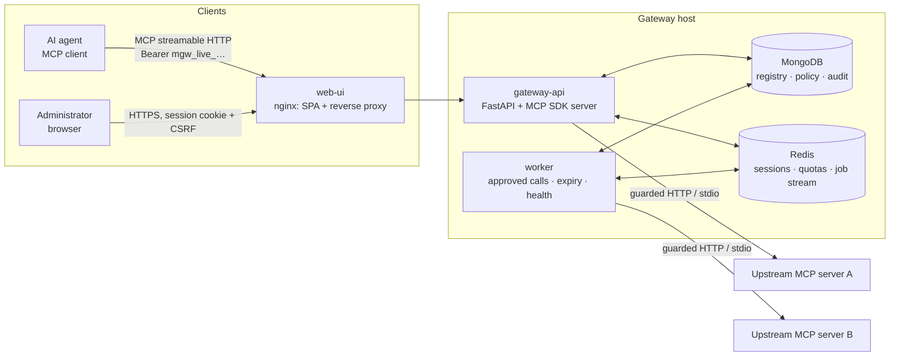
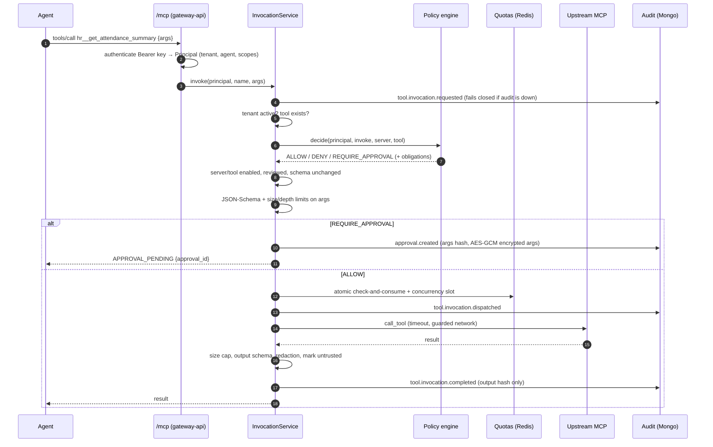
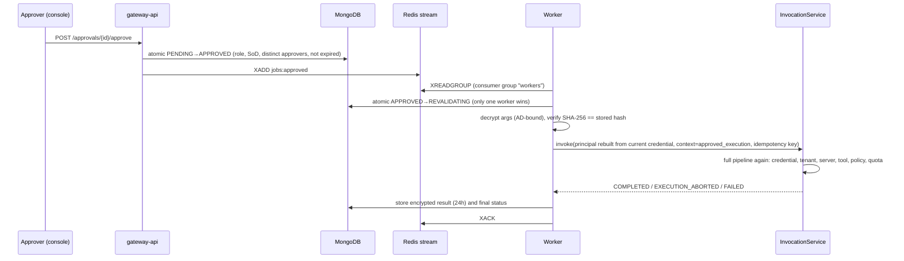

# Architecture

## Components



| Component | Responsibility |
|---|---|
| **web-ui** | Static React console. Proxies `/api`, `/mcp` and `/health` to gateway-api, with a strict CSP. |
| **gateway-api** | REST API (`/api/v1`) and the gateway MCP endpoint (`/mcp`). All business logic. |
| **worker** | Same image. Consumes the `jobs:approved` Redis stream, expires approvals, re-queues stuck jobs, runs upstream health checks, writes a heartbeat. |
| **MongoDB** | Durable state: tenants, users, memberships, agents, credentials (hashes), servers, tools, tool versions, policies, approvals, invocations, append-only audit events, usage counters, system settings, encrypted secrets. |
| **Redis** | Sessions, login throttling, quota windows and counters, concurrency slots, the approval job stream. |

### Backend layering

```
api/v1/*            thin routes: parse, authorize role, call a service, serialize (whitelisted fields)
services/*          business rules (registry, identity, auth, policy, validation, quota, approval, invocation, audit, usage)
repositories/*      the only Mongo access. TenantScopedRepository requires tenant_id; optimistic `version`
mcp/                gateway_server (MCP endpoint), client_manager + adapters (upstream), net_guard (SSRF)
workers/            Worker loop, healthcheck
core/               errors, crypto, identity/roles, logging (scrubbing), ids
```

## The invocation pipeline

`InvocationService.invoke()` is the **only** route to an upstream tool. The MCP `tools/call` handler, `POST
/api/v1/gateway/tools/{name}/invoke` and the approval worker (`execute_approved`) all use it.



A policy DENY is returned before any tool-state detail, so callers without a grant cannot probe a tool's state.

## Approval execution



Approval states: `PENDING → APPROVED → REVALIDATING → EXECUTING → COMPLETED | FAILED | EXECUTION_ABORTED`,
or `PENDING → REJECTED | EXPIRED | CANCELLED | CANCELLED_BY_ADMIN`. Every transition is a compare-and-set
on the current status.

## Data model (collections)

`tenants`, `users`, `tenant_memberships`, `agents`, `credentials`, `secrets`, `mcp_servers`, `tools`,
`tool_schema_versions`, `policies`, `approval_requests`, `invocations`, `audit_events`, `usage_counters`,
`system_settings`. Indexes are created at startup by `migrations/indexes.py`. Every tenant-owned document
carries `tenant_id`, and compound indexes lead with it.

## Design decisions and deviations

| Decision | Reason |
|---|---|
| PyMongo's native async client instead of Motor | Motor is deprecated. The spec allows either. |
| Upstream sessions per call (no long-lived pool) | Isolation between tenants and calls. Simpler failure handling. A per-server `CapacityLimiter` bounds concurrency. |
| Approval requests consume rate quota when requested, and are re-admitted (quota checked again) at execution | Prevents approval-queue flooding while still enforcing limits at execution time. |
| Approved results stored encrypted for 24 h | Lets the requesting agent poll `gateway__approval_status` for the result. |
| Mock MCP server lives in `backend/devtools/` | Used by tests, the dev stack and demos alike. |
